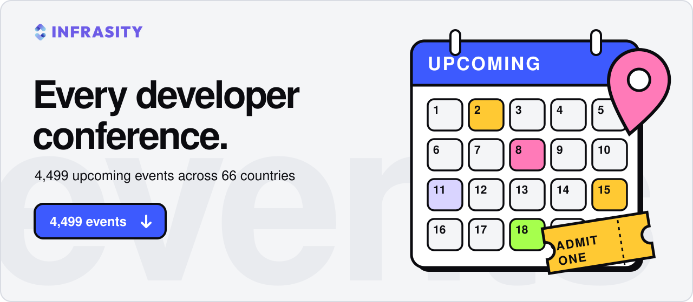
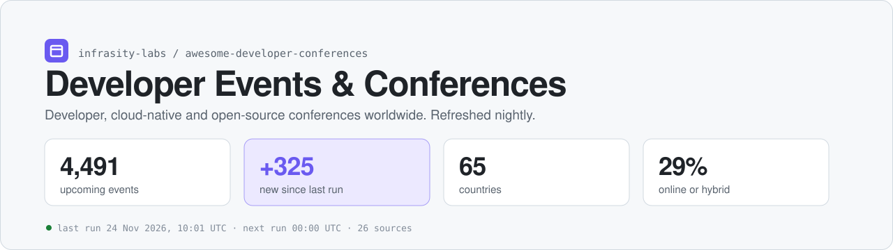
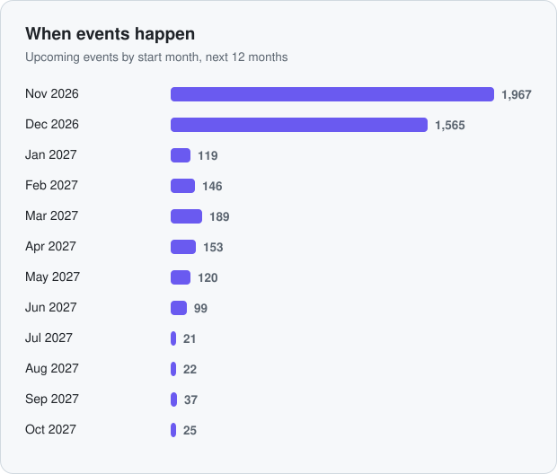
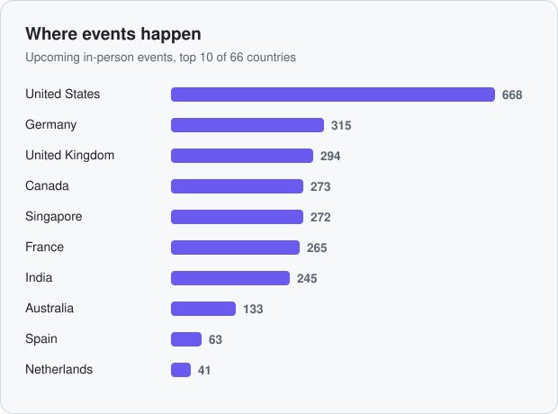
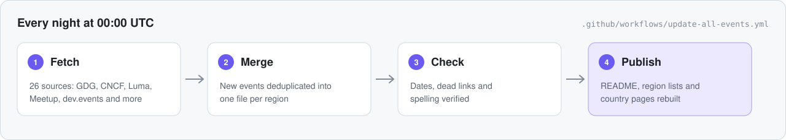

  

  <picture>
    <source media="(prefers-color-scheme: dark)" srcset="./.github/assets/banner-dark.svg">
    
  </picture>

  
  
  
  
  
  

  <b>Every developer, cloud-native and open-source conference worth knowing about, in one place.</b> 
  KubeCon, PlatformCon, DevOpsCon, Open Source Summit, DevFests and thousands more. Free, updated every night.

  <a href="#browse-by-region"><b>Browse by region</b></a> &nbsp;·&nbsp;
  <a href="#next-conferences"><b>Next conferences</b></a> &nbsp;·&nbsp;
  <a href="#browse-by-country"><b>Browse by country</b></a> &nbsp;·&nbsp;
  <a href="#how-it-works"><b>How it works</b></a> &nbsp;·&nbsp;
  <a href="#add-an-event"><b>Add an event</b></a> &nbsp;·&nbsp;
  <a href="https://github.com/Infrasity-Labs/awesome-developer-conferences/subscription"><b>Watch for updates</b></a>

## Browse by region

Every event sits in one list per region, soonest first. Events drop off a week after they end.

| Region | Upcoming | New | |
|:--|--:|--:|:--|
| [Africa](events/africa.md) | **111** | +6 | <picture>   <source media="(prefers-color-scheme: dark)" srcset="./.github/assets/bars/africa-dark.svg">    </picture> |
| [Asia](events/asia.md) | **699** | +34 | <picture>   <source media="(prefers-color-scheme: dark)" srcset="./.github/assets/bars/asia-dark.svg">    </picture> |
| [Australia](events/australia.md) | **122** | +4 | <picture>   <source media="(prefers-color-scheme: dark)" srcset="./.github/assets/bars/australia-dark.svg">    </picture> |
| [Europe](events/europe.md) | **1,210** | +88 | <picture>   <source media="(prefers-color-scheme: dark)" srcset="./.github/assets/bars/europe-dark.svg">    </picture> |
| [North America](events/north-america.md) | **859** | +124 | <picture>   <source media="(prefers-color-scheme: dark)" srcset="./.github/assets/bars/north-america-dark.svg">    </picture> |
| [South America](events/south-america.md) | **60** | +2 | <picture>   <source media="(prefers-color-scheme: dark)" srcset="./.github/assets/bars/south-america-dark.svg">    </picture> |
| [Virtual/Online](events/virtual-online.md) | **1,277** | +110 | <picture>   <source media="(prefers-color-scheme: dark)" srcset="./.github/assets/bars/virtual-online-dark.svg">    </picture> |

Bars share one scale. The darker part of each bar is events added in the last run.

## Next conferences

The next in-person conferences by start date. Community meetups from Meetup, Luma and GDG are in the regional lists.

| Conference | Date | Location | |
|:--|:--|:--|:-:|
| **AGNTCon + MCPCon** | 2026-11-22 | San Jose, CA (USA) | [Register ↗](https://events.linuxfoundation.org/agntcon-mcpcon-north-america/) |
| **GopherCon India** | 2026-11-22 | Hyderabad, India | [Register ↗](https://gopherconindia.org/) |
| **Reality Check - Delhi Edition** | 2026-11-22 | New Delhi (India) | [Register ↗](https://www.commudle.com/communities/noclue/events/reality-check-delhi-edition) |
| **WordCamp Bengaluru** | 2026-11-22 | Bangalore, India | [Register ↗](https://bengaluru.wordcamp.org/2026) |
| **API Conference Berlin** | 2026-11-23 to 2026-11-27 | Berlin (Germany) | [Register ↗](https://apiconference.net/berlin) |
| **DDC .NET Developer Conference** | 2026-11-23 to 2026-11-26 | Köln (Germany) | [Register ↗](https://www.developer-world.de/ddc) |
| **DSC Europe (Data Science Conference) 2026** | 2026-11-23 to 2026-11-27 | Belgrade, Serbia | [Register ↗](https://datasciconference.com/) |
| **MLCon Berlin 2026** | 2026-11-23 to 2026-11-27 | Berlin (Germany) | [Register ↗](https://mlconference.ai/berlin/) |
| **TGB AI CXO Summit 2026** | 2026-11-23 | Singapore | [Register ↗](https://dev.events/conferences/tgb-ai-cxo-summit-2026-auvumstp) |
| **AI Summit Europe 2026** | 2026-11-24 to 2026-11-27 | Vilnius | [Register ↗](https://dev.events/conferences/ai-summit-europe-2026-dxbmujlg) |

## Events at a glance

<picture>
  <source media="(prefers-color-scheme: dark)" srcset="./.github/assets/by-month-dark.svg">
  
</picture>
<picture>
  <source media="(prefers-color-scheme: dark)" srcset="./.github/assets/top-countries-dark.svg">
  
</picture>

## Browse by country

Jump straight to upcoming in-person events in a country. Each page is rebuilt nightly.

| Country | Upcoming |
|:--|--:|
| [United States](countries/united-states.md) | 596 |
| [Germany](countries/germany.md) | 307 |
| [United Kingdom](countries/united-kingdom.md) | 304 |
| [Canada](countries/canada.md) | 275 |
| [France](countries/france.md) | 263 |
| [Singapore](countries/singapore.md) | 249 |
| [India](countries/india.md) | 235 |
| [Australia](countries/australia.md) | 119 |
| [Spain](countries/spain.md) | 60 |
| [Netherlands](countries/netherlands.md) | 39 |
| [Nigeria](countries/nigeria.md) | 39 |
| [Italy](countries/italy.md) | 36 |

<b>Show 53 more countries</b>

| Country | Upcoming |
|:--|--:|
| [Japan](countries/japan.md) | 34 |
| [Brazil](countries/brazil.md) | 32 |
| [Indonesia](countries/indonesia.md) | 25 |
| [Kenya](countries/kenya.md) | 24 |
| [Poland](countries/poland.md) | 23 |
| [Egypt](countries/egypt.md) | 19 |
| [South Korea](countries/south-korea.md) | 18 |
| [Taiwan](countries/taiwan.md) | 17 |
| [United Arab Emirates](countries/united-arab-emirates.md) | 15 |
| [China](countries/china.md) | 14 |
| [Switzerland](countries/switzerland.md) | 14 |
| [Sweden](countries/sweden.md) | 11 |
| [Philippines](countries/philippines.md) | 10 |
| [Portugal](countries/portugal.md) | 10 |
| [Türkiye](countries/t-rkiye.md) | 9 |
| [Israel](countries/israel.md) | 8 |
| [Mexico](countries/mexico.md) | 8 |
| [South Africa](countries/south-africa.md) | 7 |
| [Colombia](countries/colombia.md) | 5 |
| [Argentina](countries/argentina.md) | 2 |
| [Belgium](countries/belgium.md) | 15 |
| [Pakistan](countries/pakistan.md) | 12 |
| [Czechia](countries/czechia.md) | 11 |
| [Greece](countries/greece.md) | 10 |
| [Vietnam](countries/vietnam.md) | 10 |
| [Austria](countries/austria.md) | 9 |
| [Cameroon](countries/cameroon.md) | 9 |
| [Denmark](countries/denmark.md) | 9 |
| [Finland](countries/finland.md) | 8 |
| [Hungary](countries/hungary.md) | 8 |
| [Malaysia](countries/malaysia.md) | 8 |
| [Norway](countries/norway.md) | 8 |
| [Peru](countries/peru.md) | 8 |
| [Bulgaria](countries/bulgaria.md) | 7 |
| [Latvia](countries/latvia.md) | 7 |
| [Lithuania](countries/lithuania.md) | 7 |
| [Jordan](countries/jordan.md) | 5 |
| [Morocco](countries/morocco.md) | 5 |
| [Nepal](countries/nepal.md) | 5 |
| [Saudi Arabia](countries/saudi-arabia.md) | 5 |
| [Serbia](countries/serbia.md) | 5 |
| [Estonia](countries/estonia.md) | 3 |
| [Ireland](countries/ireland.md) | 3 |
| [Tunisia](countries/tunisia.md) | 3 |
| [Bangladesh](countries/bangladesh.md) | 2 |
| [Croatia](countries/croatia.md) | 2 |
| [Qatar](countries/qatar.md) | 2 |
| [Romania](countries/romania.md) | 2 |
| [Rwanda](countries/rwanda.md) | 2 |
| [Thailand](countries/thailand.md) | 2 |
| [New Zealand](countries/new-zealand.md) | 1 |
| [Senegal](countries/senegal.md) | 1 |
| [Sri Lanka](countries/sri-lanka.md) | 1 |

## How it works

<picture>
  <source media="(prefers-color-scheme: dark)" srcset="./.github/assets/pipeline-dark.svg">
  
</picture>

Don't edit `README.md`, `countries/` or `.github/assets/` by hand: the next run rebuilds them. The event tables you can edit live in [`events/`](./events).

## Add an event

  
  

Know a conference we are missing? Open an issue, or add a row to the right file in [`events/`](./events) and send a pull request. The format and the fetcher guide are in [CONTRIBUTING.md](./CONTRIBUTING.md).

---

  Maintained by <a href="https://infrasity.com"><b>Infrasity</b></a>, a developer marketing agency for DevTools and B2B SaaS. We run this in public because we work in this space every day. 
  <a href="https://infrasity.com">Website</a> · <a href="https://linkedin.com/company/infrasity">LinkedIn</a> · <a href="./LICENSE">MIT License</a> · <a href="./CODE_OF_CONDUCT.md">Code of Conduct</a>

